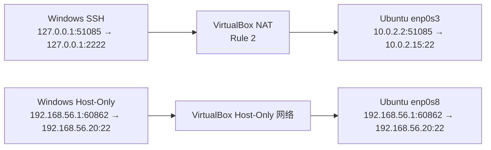

# 04 · Windows → Ubuntu 的 SSH 转发与 Host-Only 直连

2026-11-18 在同一台 Windows 主机与 VirtualBox Ubuntu 虚拟机之间做了两组 SCP 上传。Host-Only 直连可用。每条路径各上传三次同一个 MP4，六次 SHA-256 全部匹配。NAT 转发的总耗时中位数为 **2.240 秒**，Host-Only 为 **1.324 秒**。

## 拓扑与连接证据

Windows 11 运行 VirtualBox 7.2.2r170484，目标虚拟机为 `My-First-Linux-VM`，系统为 Ubuntu 24.04.4 LTS。网卡 1 为 NAT，对应 Ubuntu `enp0s3`（`10.0.2.15/24`）。网卡 2 接入 `VirtualBox Host-Only Ethernet Adapter`，对应 Ubuntu `enp0s8`（`192.168.56.20/24`）。Windows 的 Host-Only 网卡地址为 `192.168.56.1/24`。Ubuntu 的 `ss` 显示 sshd 在 `0.0.0.0:22` 和 `[::]:22` 监听。

- **NAT 转发**。`ssh -G ubuntu` 展开为 `wyh@127.0.0.1:2222`。Windows 的 TCP 表将 `127.0.0.1:2222` 的监听进程归属到 `VirtualBoxVM`。`VBoxManage showvminfo --machinereadable` 给出的规则是 `Forwarding(1)="Rule 2,tcp,127.0.0.1,2222,,22"`。规则的客机地址字段留空，实际在 `enp0s3` 收到的目标为 `10.0.2.15:22`。
- **Host-Only 直连**。Windows 到 `192.168.56.20` 的路由选择 `192.168.56.1` 和链路直达的 `192.168.56.0/24`，Ubuntu 的回程路由走 `enp0s8`。抓包记录了 Windows 发起的 ARP 查询和 Ubuntu 的应答，Windows 邻居表为 `Reachable`，MAC `08-00-27-A2-D2-9E` 与 VirtualBox 网卡 2 一致。随后抓到 TCP SYN 和 SYN-ACK，SSH 通过公钥认证并在 Ubuntu 执行命令成功。直连验证复用了已信任的同一台 Ubuntu 的 SSH 主机密钥。

下图端口取自两次独立探测。Windows 端在 SSH 会话存续时用 `Get-NetTCPConnection -OwningProcess` 取得 `Established` 套接字。Ubuntu 端用同一会话的 `SSH_CONNECTION` 和入站 SYN 核对。



同一份 Ubuntu 抓包中，两次探测的 SYN 分别出现在 `11:46:02.864173 UTC`（`enp0s3`）和 `11:46:09.244075 UTC`（`enp0s8`）。NAT 规则和两端的连接记录共同表明，目标端口在 **Windows 上的 VirtualBox NAT 转发边界**由 `2222` 映射到 `22`。Ubuntu 看到的源地址是 NAT 侧的 `10.0.2.2`，本次探测两侧的源端口都为 `51085`。Host-Only 探测的四元组在两端一致，目的端口始终为 `22`。

## SCP 实测

Windows 向 Ubuntu 上传仓库外已有的 `BV1Fb4111732_p1.mp4`，大小为 **36,881,744 字节**（约 35.17 MiB）。Windows 源文件、Ubuntu 上已有的样本和六份新上传文件 SHA-256 均为 `5d1f9fdd32d7aeec7b195f169381f8ae43a9028770044bd19777696961346c6e`。

每轮启动独立的 Windows OpenSSH 9.5p2 `scp` 进程，通过默认的 SFTP 模式连接 Ubuntu OpenSSH 9.6p1。两组均使用 `chacha20-poly1305@openssh.com`，禁用 SSH 压缩和连接复用，写入同一 Ubuntu 目录下不同的文件名。Windows `Stopwatch` 从调用 `scp` 计到进程退出，包含进程启动、连接和认证、SFTP 文件传输及会话收尾。吞吐量为样本字节数 ÷ 1,048,576 ÷ 总秒数。计时外进行哈希校验。

| 实际顺序 | 路径 | Ubuntu 入站 SYN（源 → 目的） | 总耗时（秒） | 吞吐量（MiB/s） | SHA-256 |
| --- | --- | --- | ---: | ---: | --- |
| 1 | NAT 1 | `10.0.2.2:54108 → 10.0.2.15:22` | 2.261 | 15.55 | 通过 |
| 2 | Host-Only 1 | `192.168.56.1:54120 → 192.168.56.20:22` | 1.324 | 26.56 | 通过 |
| 3 | Host-Only 2 | `192.168.56.1:61265 → 192.168.56.20:22` | 1.271 | 27.66 | 通过 |
| 4 | NAT 2 | `10.0.2.2:61271 → 10.0.2.15:22` | 2.240 | 15.70 | 通过 |
| 5 | NAT 3 | `10.0.2.2:49946 → 10.0.2.15:22` | 2.198 | 16.00 | 通过 |
| 6 | Host-Only 3 | `192.168.56.1:49963 → 192.168.56.20:22` | 1.510 | 23.30 | 通过 |

| 路径 | 总耗时中位数（秒） | 吞吐量中位数（MiB/s） |
| --- | ---: | ---: |
| NAT 转发 | 2.240 | 15.70 |
| Host-Only 直连 | 1.324 | 26.56 |

测速窗口为 Windows 时钟的 `11:47:37.345–11:47:53.169 UTC`（北京时间 `19:47`）。按路径与顺序关联这六个入站 SYN，并用两端记录的时间间隔核对。测速后的四次 SSH 往返校对表明，Ubuntu 时钟约比 Windows 慢 1.1–1.4 秒。这一偏差不影响 Windows 单调计时。Ubuntu 抓包仅收相关 ARP 和带 SYN 标志的 TCP 22 包，snaplen 为 128 字节，共捕获 30 包，内核报告 0 丢包。

Windows 主机是 Ryzen 7 8845H（16 逻辑处理器），Ubuntu 分配 2 vCPU 和 8 GiB 内存。Windows 测速前后共采得 8 个 CPU 与内存样点，整机 CPU 为 **8%–36%**，可用内存 **5,485–5,498 MiB**。Ubuntu 测速窗口附近的 `vmstat` 样点中 CPU 空闲比例为 **31%–99%**，未观测到换页。测速时两台 VirtualBox 虚拟机均在运行，未隔离后台负载，也未清除文件缓存。

这台机器上，Host-Only 的三轮总耗时均低于 NAT 转发，吞吐量中位数约为 NAT 的 **1.69 倍**。结果只覆盖一份约 35 MiB 的视频、每条路径三轮单流上传。该口径包含加密、建连和文件读写，未单独测量磁盘落盘或网卡峰值，无法把耗时差单独归因于端口映射。

## 复现

在 Windows PowerShell 查配置和路由。先确认 `ubuntu` 指向目标虚拟机，再通过 `HostKeyAlias` 复用已有的 `[127.0.0.1]:2222` 主机密钥记录，保持严格校验。

```powershell
ssh -G ubuntu | Select-String '^(hostname|user|port) '
$vbox = 'C:\Program Files\Oracle\VirtualBox\VBoxManage.exe'
& $vbox showvminfo 'My-First-Linux-VM' --machinereadable |
    Select-String '^(nic[12]|hostonlyadapter2|macaddress[12]|Forwarding\()'
Get-NetTCPConnection -State Listen -LocalPort 2222
Find-NetRoute -RemoteIPAddress 192.168.56.20
ssh -oBatchMode=yes ubuntu 'echo "$SSH_CONNECTION"; sleep 15'
ssh -oBatchMode=yes -oStrictHostKeyChecking=yes -oConnectTimeout=5 -oHostName=192.168.56.20 -oHostKeyAlias=[127.0.0.1]:2222 -p 22 ubuntu 'echo "$SSH_CONNECTION"; sleep 15'
```

在另一 Windows 终端于每个探测会话的 `sleep` 期间运行 `Get-NetTCPConnection -State Established -RemotePort 2222,22`，查看 `LocalAddress`、`LocalPort`、`RemoteAddress` 和 `RemotePort`。用 `Get-NetNeighbor -IPAddress 192.168.56.20` 核对直连的邻居状态。

在 Ubuntu 终端设定仓库外的新输出目录，在 Windows 端使用相同的末级目录名。下面沿用已有的抓包 Docker 镜像。抓包启动后运行 Windows 探测和测速，结束后在 Ubuntu 按 Ctrl+C，并用 `tcpdump` 读回记录。测速开始前可在独立 Ubuntu 终端运行 `TZ=UTC vmstat -n -w -t -y 1 30` 记录负载。Windows 可在独立 PowerShell 中定期读取 `Win32_PerfFormattedData_PerfOS_Processor` 的 `_Total.PercentProcessorTime` 和 `Win32_PerfFormattedData_PerfOS_Memory` 的 `AvailableMBytes`。

```bash
lab="$HOME/Downloads/bilibili-network/04-ssh-replay"
mkdir -m 700 -- "$lab"
ip -br -4 addr
ip -4 route get 192.168.56.1
ss -ltn 'sport = :22'
sha256sum "$HOME/Downloads/bilibili-network/BV1Fb4111732_p1.mp4"
docker run --rm --stop-signal SIGINT --network host --cap-drop ALL --cap-add NET_RAW \
  --security-opt no-new-privileges --read-only bilibili-network-capture:tcpdump-ubuntu \
  -i any -nn -p -s 128 -Z root -w - \
  '(arp and (host 192.168.56.1 or host 192.168.56.20)) or (ip and tcp port 22 and (tcp[tcpflags] & tcp-syn != 0))' \
  >"$lab/ubuntu-ssh.pcap" 2>"$lab/capture.log"
TZ=UTC tcpdump -nn -tttt -r "$lab/ubuntu-ssh.pcap"
```

在 Windows 用同一文件交错上传。每次复现选用新目录，以便保留前一组的文件。PowerShell 的 `1MB` 为 1,048,576 字节。

```powershell
$src = Join-Path $HOME 'Downloads\bilibili-network\BV1Fb4111732_p1.mp4'
$dest = 'Downloads/bilibili-network/04-ssh-replay'
$bytes = (Get-Item -LiteralPath $src).Length
$common = @('-q','-oBatchMode=yes','-oStrictHostKeyChecking=yes','-oConnectTimeout=5',
            '-oControlMaster=no','-oCompression=no','-c','chacha20-poly1305@openssh.com')
$direct = @('-oHostName=192.168.56.20','-oHostKeyAlias=[127.0.0.1]:2222','-P','22')
$runs = foreach ($id in 'nat-1','hostonly-1','hostonly-2','nat-2','nat-3','hostonly-3') {
    $route = if ($id -like 'hostonly-*') { $direct }
    $startUtc = [DateTimeOffset]::UtcNow
    $timer = [Diagnostics.Stopwatch]::StartNew()
    scp.exe @common @route $src "ubuntu:$dest/$id.mp4"
    $timer.Stop()
    if ($LASTEXITCODE -ne 0) { throw "scp failed for $id (exit $LASTEXITCODE)" }
    $seconds = $timer.Elapsed.TotalSeconds
    [pscustomobject]@{ Run=$id; StartUtc=$startUtc; Seconds=$seconds; MiBps=$bytes / 1MB / $seconds }
    Start-Sleep -Seconds 1
}
$runs | Format-Table
$runs | Group-Object { ($_.Run -split '-')[0] } | ForEach-Object {
    $median = ($_.Group | Sort-Object Seconds)[1]
    [pscustomobject]@{ Path=$_.Name; MedianSeconds=$median.Seconds; MedianMiBps=$median.MiBps }
}
$expected = (Get-FileHash -Algorithm SHA256 -LiteralPath $src).Hash.ToLowerInvariant()
$checks = ssh -oBatchMode=yes ubuntu "cd ~/$dest && sha256sum -- nat-{1,2,3}.mp4 hostonly-{1,2,3}.mp4"
if ($LASTEXITCODE -ne 0 -or @($checks).Count -ne 6) { throw 'Could not read six upload hashes' }
foreach ($line in $checks) {
    if (($line -split '\s+')[0] -cne $expected) { throw "SHA-256 mismatch for $line" }
    $line
}
```

## 原始记录

- Windows 的记录在 `C:\Users\wyh15\Downloads\bilibili-network\04-ssh-transfer-paths-20261118-1145Z\`。`windows-network.log` 保存网络与转发配置，`nat-ssh-probe.log` 和 `hostonly-ssh-probe.log` 保存 Windows 套接字、SSH 调试输出和 Ubuntu 四元组。`windows-scp.csv`、`windows-load.csv`、`clock-offset.csv`、`ubuntu-uploads.sha256` 和 `ubuntu-ssh.pcap` 保存计时、负载、时钟校对、哈希和 Ubuntu 抓包副本。
- Ubuntu 的记录在 `~/Downloads/bilibili-network/04-ssh-transfer-paths-20261118-1145Z/`，含 `ubuntu-ssh.pcap`、`ubuntu-ssh-tuples.log`、`capture.log`、`ubuntu-load.log` 及六份 MP4。Windows 和 Ubuntu 上用于比对的原样本均在各自的 `Downloads/bilibili-network/`。
