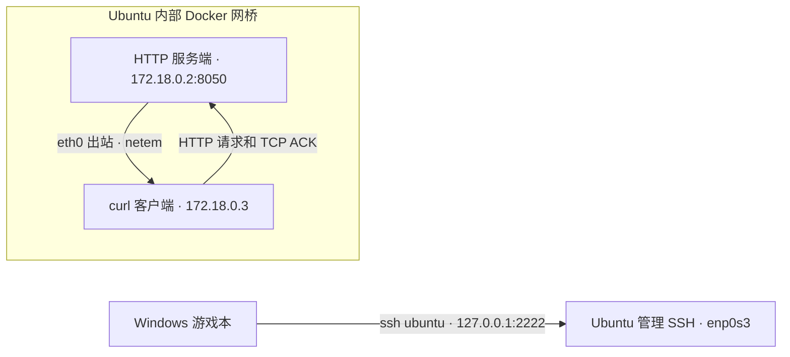

# 08 · TCP 丢包与传输恢复

2026-11-20（北京时间），从 Windows 游戏本通过 `ssh ubuntu` 在 Ubuntu 虚拟机上协调实验。无丢包、配置 1% 和配置 3% 三组各下载五次，同一份 8 MiB 文件的十五次 SHA-256 均通过。另在一条测试连接传输中途从服务端销毁套接字，再用新连接完整取回。

## 拓扑与计量



沿用[实验 05](05-tcp-latency.md)的本地工具镜像构建方式和 Docker 内部网桥。BusyBox 监听容器内的 TCP 8050，Docker 未发布端口。`netem` 只作用于服务端容器 `eth0` 的出站队列。管理 SSH 仍经宿主 Windows 的 NAT 转发进入 Ubuntu `enp0s3`。客户端的请求和 ACK 从客户端容器发出，此方向未配置丢包。

用 `/dev/urandom` 自生成 8,388,608 字节，SHA-256 为 `9b53b308c4527a5736e834d9d062b54f5a61219cd0715ea1984d3059c7fcaaf2`。三组共用同一文件、同一 URL 和相同的 HTTP/1.1 curl 参数，每次新建连接。每轮轮换各组的执行顺序，每次重建服务端队列。两端容器的 `eth0` 均关闭 TSO、GSO、GRO，并设 `gso_max_size 1514 gso_max_segs 1`，约束队列中的分段聚合。试跑只关闭 offload 时，队列丢弃计数与逐段传输差异较大，因此加入分段上限后重新测了全部三组。

- **耗时和吞吐**取 curl 的 `time_total` 和 `speed_download`，分别换算为 ms 和 MiB/s。计时从本次请求开始到结束，SHA-256 在计时后校验。
- **队列计数**取每轮下载前后的 `tc -s qdisc` 差值。实测队列丢弃比例为 `dropped ÷ (Sent packets + dropped)`，统计对象是该队列处理的包，包含 TCP 控制包、重传包等。
- **TCP 重传计数**取服务端容器 `/proc/net/snmp` 的 `TcpRetransSegs` 差值。客户端 `eth0` 的抓包用 128 字节 snaplen 保留报头和 TCP 序列号，正式丢包数据的十五份抓包均报告 0 个内核抓包丢包。

## 可恢复丢包逐轮结果

全部轮次均返回 HTTP 200，收到 8,388,608 字节并通过 SHA-256。表内 `Sent`、`Drop` 和重传为当轮计数。

| 配置丢包率 | 轮次 | 总耗时 (ms) | 吞吐量 (MiB/s) | Sent | Drop | TCP 重传 | SHA-256 |
| --- | ---: | ---: | ---: | ---: | ---: | ---: | --- |
| 0% | 1 | 71.415 | 112.021 | 5817 | 0 | 1 | 通过 |
| 0% | 2 | 77.500 | 103.226 | 5802 | 0 | 2 | 通过 |
| 0% | 3 | 75.305 | 106.235 | 5812 | 0 | 0 | 通过 |
| 0% | 4 | 64.563 | 123.910 | 5800 | 0 | 2 | 通过 |
| 0% | 5 | 64.898 | 123.270 | 5808 | 0 | 3 | 通过 |
| 1% | 1 | 100.496 | 79.605 | 5803 | 46 | 46 | 通过 |
| 1% | 2 | 67.307 | 118.858 | 5799 | 45 | 45 | 通过 |
| 1% | 3 | 85.844 | 93.192 | 5798 | 60 | 60 | 通过 |
| 1% | 4 | 134.391 | 59.528 | 5811 | 60 | 60 | 通过 |
| 1% | 5 | 102.208 | 78.272 | 5807 | 70 | 70 | 通过 |
| 3% | 1 | 325.099 | 24.608 | 5803 | 153 | 153 | 通过 |
| 3% | 2 | 856.019 | 9.346 | 5799 | 191 | 191 | 通过 |
| 3% | 3 | 103.421 | 77.354 | 5803 | 189 | 189 | 通过 |
| 3% | 4 | 188.337 | 42.477 | 5818 | 161 | 161 | 通过 |
| 3% | 5 | 393.339 | 20.339 | 5804 | 190 | 190 | 通过 |

| 配置丢包率 | 实测队列丢弃 | TCP 重传合计 | 耗时中位数 (ms) | 吞吐中位数 (MiB/s) |
| --- | ---: | ---: | ---: | ---: |
| 0% | 0 / 29,039（0.000%） | 8 | 71.415 | 112.021 |
| 1% | 281 / 29,299（0.959%） | 281 | 100.496 | 79.605 |
| 3% | 884 / 29,911（2.955%） | 884 | 325.099 | 24.608 |

配置值是随机丢包参数，实测值来自队列计数。三组的耗时中位数随配置丢包率上升，3% 的单次耗时从 103.421 ms 到 856.019 ms。0% 组队列丢弃为零，服务端仍记录了 8 次重传，原因未作归因。重传和队列丢弃是不同观测量。本组数据只覆盖同一虚拟机内的短链路、一个文件和每配置五次。

### 3% 第 1 轮的 TCP 恢复

`loss3-round1.pcap` 记录 `172.18.0.2:8050 → 172.18.0.3:50814`。下表时间为 Unix 秒，序列号区间右端为开区间。

| 抓包帧 | 时间 | 客户端看到的事件 |
| --- | --- | --- |
| 40 | `1795159309.235426` | 先收到更高序列号 `3623623325:3623624773`，长度 1,448 字节。 |
| 41 | `1795159309.235431` | 累计 ACK 停在 `3623621877`，SACK 同时确认上述高序列号区间，标出前面的空洞。 |
| 61 | `1795159309.235636` | 服务端补发 `3623621877:3623623325`，正好填补空洞。 |
| 62 | `1795159309.235890` | 客户端累计 ACK 前进到 `3623645045`，确认连续接收已越过缺口。 |

从 SACK 到补段到达为 0.205 ms，到累计 ACK 越过缺口为 0.459 ms。客户端抓包位于队列下游，通过空洞、SACK、补段和 ACK 前进判定这次恢复，服务端同期记录 153 个队列丢弃和 153 次 TCP 重传。连接保持同一四元组，curl 的一次请求最终收到完整文件。

## 单连接中断与重新请求

中断组保留相同拓扑和同一文件，将随机丢包设为 0，单独给服务端出站队列设 `rate 8mbit`，客户端用 `--limit-rate 1M`，以便在连接仍存续时观测残片。Windows 通过 SSH 协调的脚本在客户端磁盘出现 131,072 字节时，用服务端容器内的 `ss -K` 精确匹配客户端 IP、客户端临时端口和服务端 TCP 8050，销毁这一个已建立的套接字。BusyBox 的监听 socket 在 `ss` 中显示 IPv4 映射地址，抓包中的连接为 IPv4。

| 证据 | 时间或结果 |
| --- | --- |
| `interrupt.pcap` 帧 1 | `1795159443.027226`，客户端 `172.18.0.3:47794` 向 `172.18.0.2:8050` 发 SYN。 |
| `interrupt.pcap` 帧 526 | `1795159443.540517`，服务端对同一连接发 RST/ACK。 |
| 第一条 curl 退出 | 状态 `56`，报 `Connection reset by peer`。已收到 HTTP 200 响应头，但只得到 487,976 字节，`interrupt.part` 仍留在磁盘。 |
| `retry.pcap` 帧 1 | `1795159445.135755`，客户端改用临时端口 `57678` 发新 SYN。 |
| 第二条 curl 完成 | 普通 GET 从头读取，HTTP 200，8.768758 秒收到 8,388,608 字节，SHA-256 通过。 |

中断抓包保存了 543 帧。重新请求抓包保存了 8,025 帧，过滤器报告收到 8,776 帧，内核报告丢包为 0。重试用该抓包确认新 SYN，用 curl 与 SHA-256 确认完整收件。验证结束后由实验脚本删除两次请求的 `.part`。

- **传输层**。随机丢包发生时，TCP 在原连接中补发缺失序列范围，客户端累计 ACK 继续前进。服务端主动重置时，原连接退出。
- **应用层**。curl 报错后，实验脚本发起第二次 HTTP 请求，通过新连接完整下载。第二次请求未设置 Range，也未从中断字节继续。
- **工具的文件处理**。本次 curl 保留了显式输出的残片，由实验脚本清理。[实验 07](07-download-timing.md) 中，Windows 下载入口在实际 SCP 写入 32,768 字节后收到进程中断后的失败状态，清理本地 `.part`。后续批次条目再次取回，只有成功才保存为 MP4。两次实验的文件清理都由调用工具完成。

## 复现

使用 Ubuntu 上对当前用户可用的 Docker，以及[实验 02](02-network-capture.md)的本地镜像 `bilibili-network-capture:tcpdump-ubuntu`。将下方 Bash 脚本保存为 Windows 的 `run-tcp-loss.sh`，在 PowerShell 运行。脚本在 Ubuntu 创建全新记录目录，结束时移除本次 Docker 容器、隔离网桥和临时工具镜像。

```powershell
Get-Content -LiteralPath .\run-tcp-loss.sh -Raw |
    ssh -oBatchMode=yes ubuntu "tr -d '\r' | bash -s"
ssh -oBatchMode=yes ubuntu 'printf "%s\n" "$SSH_CONNECTION"'
```

把首行 `RECORDS=` 打印的路径用作 Ubuntu 变量 `records`。查看 TCP 绝对序列号和原始队列计数。

```bash
records="$HOME/Downloads/bilibili-network/08-tcp-loss-uJk0Y1"
tcpdump -tt -nn -S -r "$records/loss3-round1.pcap" | nl -ba | sed -n '40,41p;61,62p'
cat "$records/loss3-round1.before.log" "$records/loss3-round1.after.log"
```


<details>
<summary>完整实验脚本</summary>

```bash
#!/usr/bin/env bash
set -euo pipefail
umask 077
export LC_ALL=C TZ=Asia/Shanghai
base="$HOME/Downloads/bilibili-network"
mkdir -p -- "$base"
out=$(mktemp -d "$base/08-tcp-loss-XXXXXX")
printf 'RECORDS=%s\n' "$out"
tag="bl-tcp08-$(basename "$out" | cut -d- -f4)"
net="$tag"
server="$tag-server"
client="$tag-client"
cap="$tag-cap"
image="bl-tcp08:$tag"
tcpdump_image=bilibili-network-capture:tcpdump-ubuntu
uid_gid="$(id -u):$(id -g)"
cap_pid=
if (( $# > 1 )); then echo "Usage: $0 [existing-payload-for-interruption-only]" >&2; exit 2; fi
network_checks() {
  ip -br -4 addr
  ip -4 route show
  tc qdisc show
}
network_checks >"$out/host-before.log"

cleanup() {
  if docker container inspect "$cap" >/dev/null 2>&1; then
    docker stop -t 5 "$cap" >/dev/null
    if [[ -n "$cap_pid" ]]; then wait "$cap_pid" || true; fi
  fi
  for name in "$client" "$server"; do
    if docker container inspect "$name" >/dev/null 2>&1; then docker rm -f "$name" >/dev/null; fi
  done
  if docker network inspect "$net" >/dev/null 2>&1; then docker network rm "$net" >/dev/null; fi
  if docker image inspect "$image" >/dev/null 2>&1; then docker image rm "$image" >/dev/null; fi
}
trap cleanup EXIT
trap 'exit 130' INT
trap 'exit 143' TERM

# As in experiment 05, package only local executables and their dynamic libraries.
python3 - "$image" <<'PY'
import re
import shutil
import subprocess
import sys
import tarfile

programs = ("/usr/bin/busybox", "/usr/bin/curl", "/usr/sbin/tc", "/usr/sbin/ss", "/usr/sbin/ethtool", "/usr/sbin/ip")
paths = {shutil.which(path.rsplit('/', 1)[1]): path.lstrip('/') for path in programs}
for path in list(paths):
    result = subprocess.run(["ldd", path], capture_output=True, text=True)
    if result.returncode and "not a dynamic executable" not in result.stdout + result.stderr:
        raise SystemExit(result.stderr)
    dependencies = result.stdout
    paths.update({lib: lib.lstrip("/") for lib in re.findall(r"(?:^\s*|=>\s+)(/\S+) \(0x", dependencies, re.MULTILINE)})
with subprocess.Popen(["docker", "import", "-", sys.argv[1]], stdin=subprocess.PIPE) as proc:
    with tarfile.open(fileobj=proc.stdin, mode="w|", dereference=True) as archive:
        for path, archive_name in sorted(paths.items()):
            archive.add(path, arcname=archive_name)
    proc.stdin.close()
    if proc.wait():
        raise SystemExit("Local image import failed")
PY

if (( $# == 1 )); then cp -- "$1" "$out/payload.bin"; else head -c 8388608 /dev/urandom >"$out/payload.bin"; fi
test "$(stat -c %s "$out/payload.bin")" = 8388608
chmod 644 "$out/payload.bin"
expected=$(sha256sum "$out/payload.bin" | cut -d ' ' -f1)
printf '%s  payload.bin\n' "$expected" >"$out/source.sha256"
docker network create --internal "$net" >"$out/network-id.log"
docker run -d --name "$server" --network "$net" --read-only --cap-drop ALL --cap-add NET_ADMIN \
  --mount "type=bind,source=$out/payload.bin,target=/payload/payload.bin,readonly" \
  "$image" /usr/bin/busybox httpd -f -p 8050 -h /payload >/dev/null
docker run -d --name "$client" --network "$net" --read-only --cap-drop ALL --cap-add NET_ADMIN \
  --mount "type=bind,source=$out,target=/output" \
  "$image" /usr/bin/busybox sleep 1200 >/dev/null
ip_of() { docker inspect --format '{{range .NetworkSettings.Networks}}{{.IPAddress}}{{end}}' "$1"; }
server_ip=$(ip_of "$server")
client_ip=$(ip_of "$client")
url="http://$server_ip:8050/payload.bin"
printf 'server=%s:8050 client=%s image=%s network=%s\n' "$server_ip" "$client_ip" "$image" "$net" | tee "$out/topology.log"
for endpoint in "$server" "$client"; do
  docker exec "$endpoint" /usr/sbin/ethtool -K eth0 tso off gso off gro off
  docker exec "$endpoint" /usr/sbin/ip link set dev eth0 gso_max_size 1514 gso_max_segs 1
  docker exec "$endpoint" /usr/sbin/ethtool -k eth0 >"$out/$endpoint-features.log"
  docker exec "$endpoint" /usr/sbin/ip -d link show dev eth0 >>"$out/$endpoint-features.log"
done

set_loss() {
  local loss=$1
  shift
  if docker exec "$server" /usr/sbin/tc qdisc show dev eth0 | grep -q '^qdisc netem '; then
    docker exec "$server" /usr/sbin/tc qdisc del dev eth0 root
  fi
  docker exec "$server" /usr/sbin/tc qdisc add dev eth0 root netem limit 10000 loss random "$loss%" "$@"
}
snapshot() {
  docker exec "$server" /usr/sbin/tc -s qdisc show dev eth0
  docker exec "$server" /usr/bin/busybox grep '^Tcp:' /proc/net/snmp
}
start_capture() {
  local capture_flags=()
  if [[ "$1" == interrupt ]]; then capture_flags=(--immediate-mode); fi
  docker run --rm --name "$cap" --stop-signal SIGINT --network "container:$client" \
    --cap-drop ALL --cap-add NET_RAW --security-opt no-new-privileges --read-only \
    "$tcpdump_image" -i eth0 "${capture_flags[@]}" -nn -p -U -s 128 -Z root -w - "host $server_ip and tcp port 8050" \
    >"$out/$1.pcap" 2>"$out/$1.capture.log" &
  cap_pid=$!
  for _ in {1..100}; do
    if grep -q 'listening on' "$out/$1.capture.log"; then return; fi
    if ! kill -0 "$cap_pid" 2>/dev/null; then break; fi
    sleep .05
  done
  cat "$out/$1.capture.log" >&2
  return 1
}
stop_capture() {
  docker stop -t 5 "$cap" >/dev/null
  wait "$cap_pid"
}
fetch() {
  local file=$1
  shift
  docker exec --user "$uid_gid" "$client" /usr/bin/curl -q --noproxy '*' --http1.1 \
    -fsS --connect-timeout 8 --max-time 60 "$@" --output "/output/$file" \
    --write-out 'code=%{http_code} local=%{local_ip}:%{local_port} remote=%{remote_ip}:%{remote_port} total_s=%{time_total} bytes=%{size_download} Bps=%{speed_download}\n' "$url"
}
verify() { printf '%s  %s\n' "$expected" "$out/$1" | sha256sum -c -; }
docker exec --user "$uid_gid" "$client" /usr/bin/curl -q --noproxy '*' -fsSI --max-time 5 "$url" >"$out/http-ready.log"

if (( $# == 0 )); then
  for round in 1 2 3 4 5; do
    case $((round % 3)) in
      1) order=(0 1 3) ;;
      2) order=(1 3 0) ;;
      0) order=(3 0 1) ;;
    esac
    for loss in "${order[@]}"; do
      id="loss$loss-round$round"
      set_loss "$loss"
      start_capture "$id"
      snapshot >"$out/$id.before.log"
      fetch "$id.bin" >"$out/$id.curl.log"
      verify "$id.bin" >"$out/$id.sha256.log"
      snapshot >"$out/$id.after.log"
      stop_capture
      rm -- "$out/$id.bin"
      printf '%s %s\n' "$id" "$(cat "$out/$id.curl.log")" | tee -a "$out/results.log"
    done
  done
fi

set_loss 0 rate 8mbit
snapshot >"$out/interrupt.qdisc.log"
start_capture interrupt
fetch interrupt.part --limit-rate 1M >"$out/interrupt.curl.log" 2>&1 &
fetch_pid=$!
partial=0
for _ in {1..200}; do
  if [[ -f "$out/interrupt.part" ]]; then partial=$(stat -c %s "$out/interrupt.part"); fi
  if ((partial >= 131072 && partial < 8388608)); then break; fi
  if ! kill -0 "$fetch_pid" 2>/dev/null; then break; fi
  sleep .02
done
if ((partial < 131072 || partial >= 8388608)); then
  printf "No in-flight partial file, size=%s\n" "$partial" >&2
  exit 1
fi
socket=$(docker exec "$server" /usr/sbin/ss -Htn state established "( sport = :8050 and dst $client_ip )")
if [[ -z "$socket" || "$socket" == *$'\n'* ]]; then
  printf "Expected exactly one established server socket, got: [%s]\n" "$socket" >&2
  exit 1
fi
peer=$(awk '{print $NF}' <<<"$socket")
peer_port=$(awk -F: '{print $NF}' <<<"$peer")
if [[ ! "$peer_port" =~ ^[0-9]+$ || ( "$peer" != "$client_ip:$peer_port" && "$peer" != "[::ffff:$client_ip]:$peer_port" ) ]]; then
  printf "Unexpected peer: [%s], socket: [%s]\n" "$peer" "$socket" >&2
  exit 1
fi
printf 'before_destroy=%s partial_bytes=%s socket=%s\n' "$(date --iso-8601=ns)" "$partial" "$socket" >"$out/interrupt.log"
docker exec "$server" /usr/sbin/ss -Ktn state established "( sport = :8050 and dst $client_ip and dport = :$peer_port )" >>"$out/interrupt.log"
rc=0
wait "$fetch_pid" || rc=$?
partial=$(stat -c %s "$out/interrupt.part")
((rc != 0 && partial > 0 && partial < 8388608))
printf 'after_destroy=%s curl_exit=%s partial_bytes=%s\n' "$(date --iso-8601=ns)" "$rc" "$partial" >>"$out/interrupt.log"
cat "$out/interrupt.curl.log" >>"$out/interrupt.log"
stop_capture
start_capture retry
fetch retry.part --limit-rate 1M >"$out/retry.curl.log"
verify retry.part >"$out/retry.sha256.log"
stop_capture
cat "$out/interrupt.log" "$out/retry.curl.log" "$out/retry.sha256.log"
rm -- "$out/interrupt.part" "$out/retry.part"

cleanup
for name in "$cap" "$client" "$server"; do ! docker container inspect "$name" >/dev/null 2>&1 || exit 1; done
! docker network inspect "$net" >/dev/null 2>&1 || exit 1
! docker image inspect "$image" >/dev/null 2>&1 || exit 1
network_checks >"$out/host-after.log"
cmp "$out/host-before.log" "$out/host-after.log"
printf 'cleanup=OK host_interfaces_routes_queues=unchanged\n' | tee "$out/cleanup.log"
trap - EXIT
```

</details>

## 原始记录与清理

Ubuntu 仓库外的 `~/Downloads/bilibili-network/08-tcp-loss-uJk0Y1/` 保存正式三组的 `results.log`、逐轮 `*.curl.log`、`*.sha256.log`、队列快照和 PCAP。`~/Downloads/bilibili-network/08-tcp-loss-WCRWsc/` 保存同一输入的中断与重新请求记录、两份 PCAP 及 `cleanup.log`。Windows 的 `per-round.csv` 包含逐轮数据和已验证的 SHA-256，与汇总及复核日志同在 `Downloads\bilibili-network\08-tcp-loss-20261120-071634Z\`。

从 Windows 重新执行 `ssh ubuntu`，认证成功，Ubuntu 记录 `10.0.2.2 59255 10.0.2.15 22`。已确认所有试跑和正式运行的临时服务、抓包容器、网桥和临时镜像均已移除，Ubuntu 宿主接口、路由和队列与预检一致。逐轮下载副本与中断残片已删除，保留样本、原始日志和抓包。
